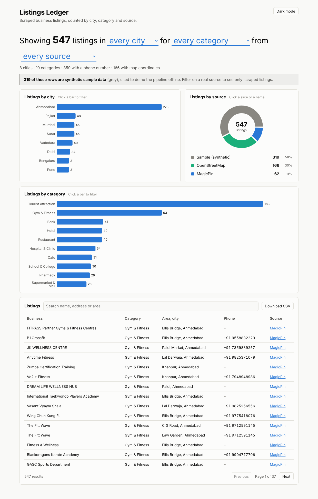

# Listings Ledger - Business Listings Dashboard

A full-stack project that takes 500+ scraped business listings, stores them in **MySQL** (`listing_master`),
exposes them through a **FastAPI** service (bulk insert + aggregated count APIs) and visualises them in a
**React** dashboard with bar and pie (donut) charts.



| | |
|---|---|
| **Frontend** | React 18, Vite, Recharts - cross-filtering charts, URL-shareable state, light/dark theme |
| **Backend** | FastAPI, SQLAlchemy 2, PyMySQL, Pydantic v2 |
| **Database** | MySQL 8 - table `listing_master` |
| **Data pipeline** | Jupyter notebooks: `00` sets up DB + API, `01` collects (OpenStreetMap Overpass + own MagicPin scrape), cleans, validates, loads and exports the `.sql` dump |
| **Tests** | pytest, 10 API tests (run on SQLite and on a MySQL-compatible server) |

## Repository layout
```
backend/      FastAPI app (app/), tests/, requirements.txt, .env.example
frontend/     React + Vite dashboard (src/)
database/     schema.sql, listing_master_dump.sql
notebooks/    01_collect_clean_load.ipynb  (the scraping / loading pipeline)
docs/         screenshots, DEMO_SCRIPT.md
docker-compose.yml   optional MySQL 8 container
```

## Fastest path: everything from Jupyter
Open `notebooks/00_setup_database_and_api.ipynb` (set `DB_MODE` to `"mysql"` or `"sqlite"`), run it top to bottom, then run
`01_collect_clean_load.ipynb`, then `cd frontend && npm install && npm run dev`. The manual steps below do the same thing in a terminal.

## Quick start (about 5 minutes)

**Prerequisites:** Python 3.10+, Node 18+, MySQL 8 (or `docker compose up -d`). Without MySQL, set `DB_MODE = "sqlite"` in notebook 00 to try the project.

```bash
# 1. Database - either load the ready-made dump (schema + 500+ rows) ...
mysql -u root -p -e "CREATE USER IF NOT EXISTS 'bl_user'@'%' IDENTIFIED BY 'bl_pass';
                     CREATE DATABASE IF NOT EXISTS business_listings;
                     GRANT ALL ON business_listings.* TO 'bl_user'@'%';"
mysql -u root -p business_listings < database/listing_master_dump.sql
#    ... or only create the empty table (schema.sql) and fill it with the notebook (step 4).

# 2. Backend
cd backend
python -m venv .venv && source .venv/bin/activate        # Windows: .venv\Scripts\activate
pip install -r requirements.txt
cp .env.example .env                                     # edit DATABASE_URL if your credentials differ
uvicorn app.main:app --reload                            # http://127.0.0.1:8000/docs

# 3. Frontend (new terminal)
cd frontend && npm install && npm run dev                # http://localhost:5173

# 4. (Optional) re-collect data: open notebooks/01_collect_clean_load.ipynb -> Restart & Run All
```

Run the tests: `cd backend && pytest -q` (set `TEST_DATABASE_URL=mysql+pymysql://...` to test against MySQL).

## API reference
Interactive docs: `http://127.0.0.1:8000/docs`

| Method & path | Purpose |
|---|---|
| `POST /api/listings/bulk` | Bulk insert up to 5000 listings. **Idempotent**: returns `{received, inserted, duplicates_skipped}` |
| `GET /api/stats/by-city` | Count per city |
| `GET /api/stats/by-category` | Count per category |
| `GET /api/stats/by-source` | Count per data source |
| `GET /api/stats/summary` | Headline numbers (total, cities, categories, with phone / coordinates) |
| `GET /api/filters` | Distinct cities / categories / sources for dropdowns |
| `GET /api/listings` | Browse with `city`, `category`, `source`, `q`, `page`, `page_size` |
| `GET /api/listings/export.csv` | CSV download of the filtered view |
| `GET /health` | Liveness + DB check |

All `stats` endpoints accept `city`, `category`, `source` filters. By default they are **cross-filters**: the
endpoint ignores its *own* dimension (`cross=true`) so sibling bars stay visible while one is selected; use
`cross=false` for strict filtering.

```bash
curl -X POST localhost:8000/api/listings/bulk -H 'Content-Type: application/json' \
  -d '{"listings":[{"business_name":"Gold Gym","category":"Gym & Fitness","city":"Ahmedabad","source":"MagicPin"}]}'
# {"received":1,"inserted":1,"duplicates_skipped":0}
```

## Database design
`listing_master`: `id`, `business_name`, `category`, `sub_category`, `address`, `area`, `city`, `state`, `phone`,
`website`, `latitude`, `longitude`, `source`, `source_url`, `fingerprint`, `scraped_at`, `created_at`.

* `fingerprint = sha256(name + city + first 40 chars of address)` with a **UNIQUE** index -> re-running a scrape or
  re-posting a payload can never create duplicates, enforced by the database, not just application code.
* Indexes on `city`, `category`, `source` and `(city, category)` keep the GROUP BY count queries fast.

## Design decisions (the "creative" parts)
* **Cross-filtering dashboard** - click a bar, a donut slice or a legend entry; every chart, the headline numbers and
  the table update. Clicking again clears. State lives in the URL hash, so a filtered view can be bookmarked or shared.
* **Filters written as a sentence** - "Showing 166 listings in *Ahmedabad* for *every category* from *OpenStreetMap*".
* **One validation model, two entry points** - the notebook imports the API's Pydantic `ListingIn`, so "a valid listing"
  is defined once.
* **Colour follows the entity** - each source keeps its colour when filters change. The palette was checked with a
  colour-vision-deficiency validator (light and dark). The table view and direct count labels back the charts up for
  accessibility.
* **Honest data labelling** - synthetic fallback rows are tagged `Sample (synthetic)`, shown grey, called out in the UI
  and removable with one SQL statement.
* **Portable SQL dump** - generated from the live DB through the API, restorable with a single `mysql <` command.

## Scraping approach and ethics
Large portals (JustDial, Google Maps, Amazon) forbid automated scraping in their Terms of Use and defend against it.
This project therefore uses:
1. **OpenStreetMap Overpass API** - openly licensed (ODbL), official query interface; per-city queries, mirror
   fail-over, on-disk cache so the service is hit once.
2. **MagicPin** public Ahmedabad Fitness pages, collected earlier with Playwright (JSON-LD parsing, polite 1.5-3 s delays,
   no login, no CAPTCHA/proxy evasion).

## Challenges and how they were solved
| Challenge | Solution |
|---|---|
| Overpass mirrors return 502/504 (Pune never succeeded) | Mirror fail-over, timeouts, local cache, re-runnable per city |
| Duplicate businesses across runs/sources | DB-level unique fingerprint + `INSERT IGNORE` + pre-check for exact counts |
| Messy phones, whitespace, casing | Shared Pydantic normalisation (`+91 XXXXXXXXXX`, title-cased cities) |
| Unfiltered `COUNT(*)` returned 1 | Found while running the notebook end-to-end; fixed with an explicit `FROM` and a regression test |
| Pie charts with many slices are unreadable | Pie used only for *source* (3 slices); city/category use ranked bars |

## Data and limitations
* **Data:** 2,213 real listings - 155 gyms from MagicPin (Ahmedabad) and 2,058 businesses/attractions from
  OpenStreetMap - across 7 cities (Ahmedabad, Mumbai, Delhi, Bengaluru, Surat, Vadodara, Rajkot) and 10 categories.
  No synthetic data is included in the submitted dump.
* **Pune was skipped:** the public Overpass API kept returning 502/504 errors for it. The notebook caches every
  successful city, so re-running it only requests missing cities.
* **Sparse phone numbers:** OpenStreetMap rarely has phone data, so most phone numbers come from MagicPin.
* **Offline fallback:** if fewer than 500 real rows are collected, the notebook adds rows tagged `Sample (synthetic)`
  (shown in grey in the dashboard, removable with `DELETE FROM listing_master WHERE source='Sample (synthetic)'`).
  This did not trigger for the submitted data.
* **No authentication** on the API - fine for an assignment, not for production.
